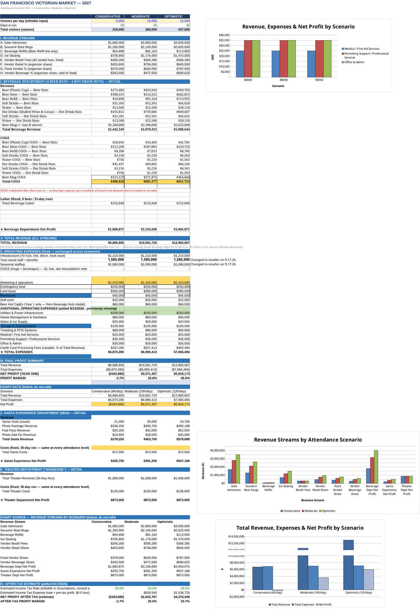
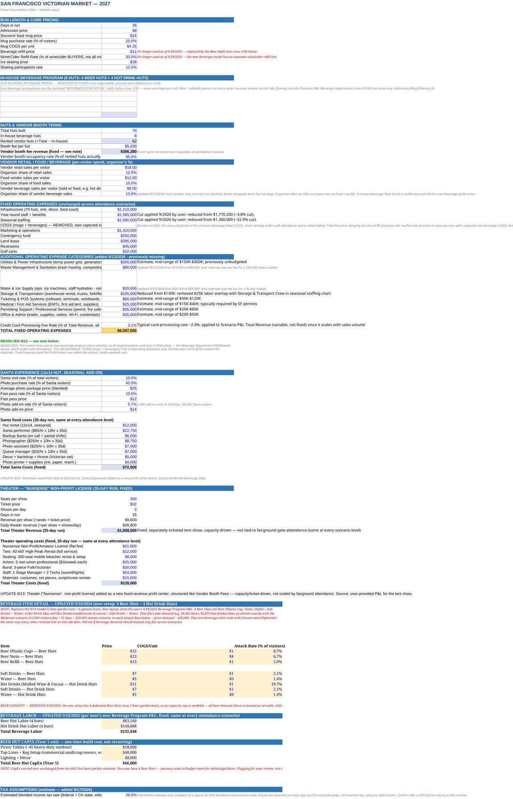
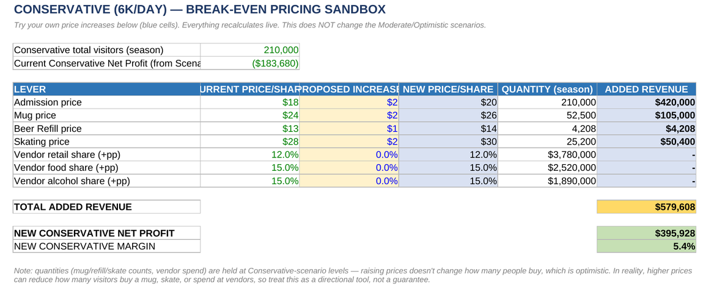

# Victorian Market Financial Model — Excel

A financial model I built in Excel for a proposed Victorian Christmas market in San Francisco — a 35-day seasonal event with vendor huts, an in-house beverage program, ice skating, a Santa experience, and a theater tent. I created it as the analysis behind an entrepreneurship contest submission.

The workbook has about 300 live formulas across 3 sheets. It is a driver-based model: change an input on the Assumptions sheet and the whole P&L recalculates.

**A note on the figures:** the screenshots below come from a showcase copy of the model. The input figures (prices, attendance, cost estimates) have been changed to illustrative values, because the live model's numbers are proprietary. The structure, formulas, and analysis are the real work. The workbook itself is available to employers on request — it is not posted publicly.

## What this project answers

- Can this market make money — and at what attendance level does it break even?
- Which departments carry the profit, and which are fixed-cost anchors?
- If the conservative case loses money, exactly which price changes fix it, and by how much?
- How sensitive is the result to ticket, mug, skating, and vendor-share pricing?

## The 3 sheets

1. **Scenario P&L** — the full profit & loss at three attendance levels (Conservative / Moderate / Optimistic), with the beverage department, Santa experience, and theater broken out as their own profit centers
2. **Assumptions** — every driver in one place: pricing, purchase and participation rates, hut and vendor terms, fixed operating costs, and per-item beverage pricing, COGS, and attach rates
3. **Break-Even Levers** — a pricing sandbox: type in a price increase and watch added revenue and the new conservative-case profit recalculate live

## Screenshots

**Scenario P&L**

**Assumptions**

**Break-Even Levers**

## What the model shows (illustrative figures)

- **Attendance is the whole ballgame:** at 6,000 visitors a day the market loses $183,680 (−2.7% margin); at 10,000 a day it nets $3,571,307 (33.8%); at 12,500 a day, $5,918,173 (45.6%). Fixed costs barely move — the scenarios live or die on volume.
- **The beverage department is the profit engine:** $1.8M to $4.0M of net profit across the scenarios, ahead of gate admission — the souvenir boot mugs alone outsell the gate in the moderate and optimistic cases.
- **The conservative case is fixable with small prices, not big ones:** four modest levers — admission +$2, mugs +$2, refills +$1, skating +$2 — add $579,608 and flip the conservative case to a $395,928 profit (5.4% margin), with no change to attendance assumptions.
- **Built to be re-run:** every figure traces back to a driver on the Assumptions sheet, so the whole model can be re-run for a different city, season, or attendance level just by changing the inputs.

## Skills used

Excel financial modeling, driver-based assumption design, scenario analysis, break-even and sensitivity analysis, departmental P&L structure, formula documentation and audit notes, and scenario charts.

## Files in this project

- Screenshots of all 3 sheets (in this folder)
- The live workbook is not posted — it is available to employers on request
